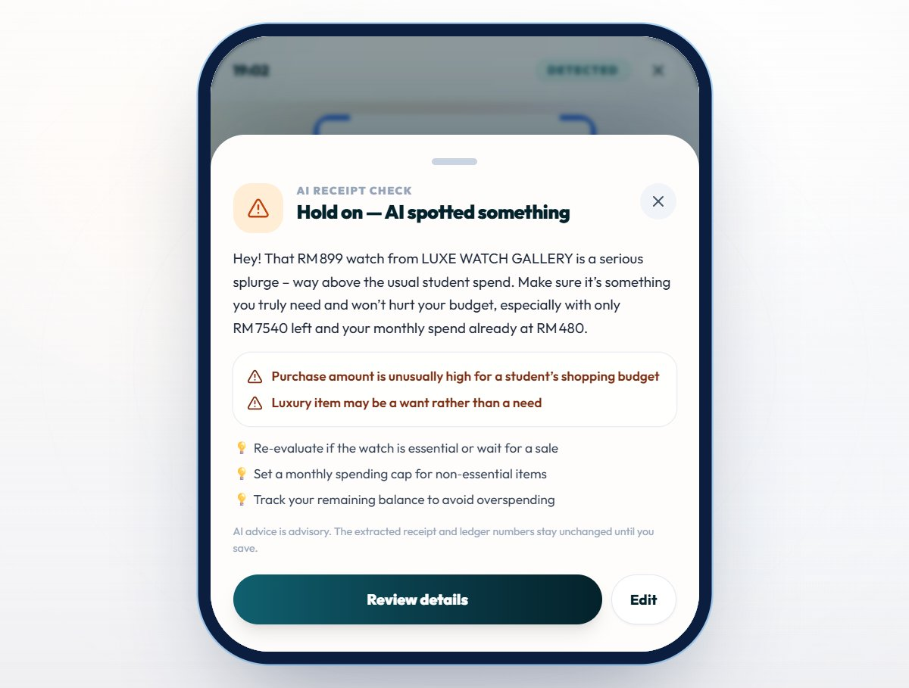
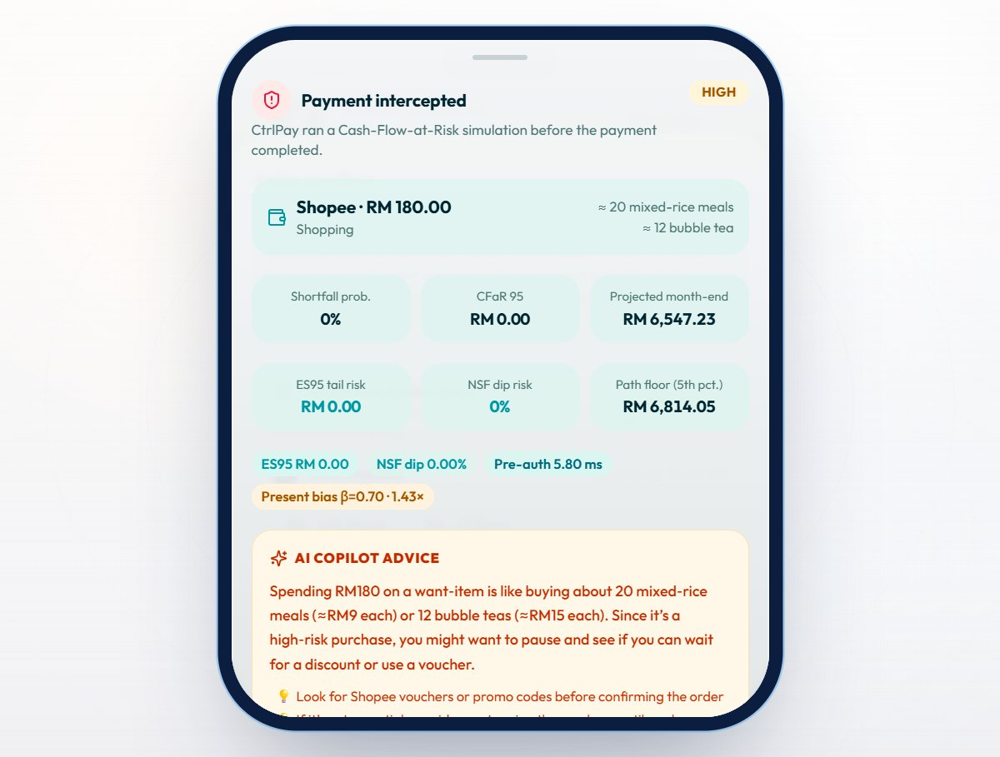
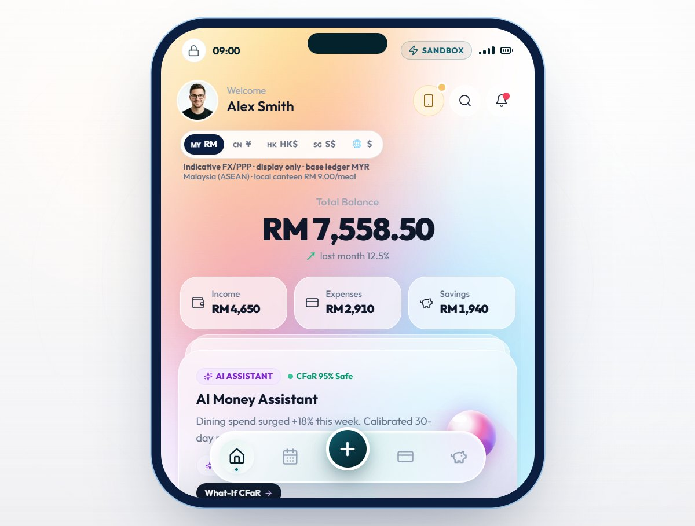
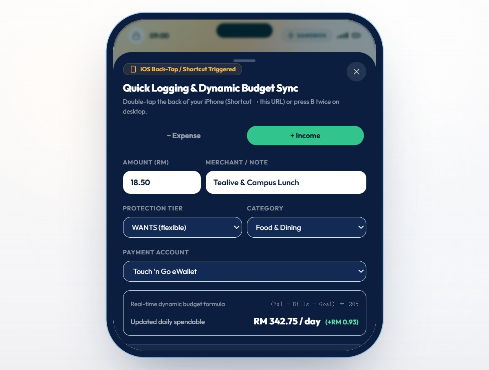

# Live production verification

**Date:** 20 October 2026 (Asia/Shanghai)
**Production URL:** <https://ctrlpay-new-bee4.vercel.app>
**Verified commit:** `30049eb` (deployed through the GitHub Actions → Vercel workflow)

The production deployment is public and returns `200` without a Vercel login.
The response headers include the hardened CSP (`wasm-unsafe-eval` and
`worker-src 'self' blob:` for the self-hosted OCR worker) and
`Permissions-Policy: camera=(self)`.

## AI provider

The Vercel project contains a Vercel AI Gateway credential
(`AI_GATEWAY_API_KEY`) but no direct `GROQ_API_KEY`. The client therefore uses
AI Gateway, pins routing to the **Groq** provider, and keeps the
`openai/gpt-oss-120b` model. If a direct `GROQ_API_KEY` is added later, the
client prefers it automatically; the gateway is only a fallback.

## Verified live flows

| Flow | Result | Evidence |
|---|---|---|
| Free-form Copilot chat | Returned a live, streamed budgeting answer through the Groq-hosted model | — |
| OCR receipt → advisory warning | Tesseract extracted `LUXE WATCH GALLERY` / `RM 899.00`; the live AI returned a warning and the modal opened with “Hold on — AI spotted something” | `production-ocr-ai-warning.jpeg` |
| Payment interception | A Shopee RM 180 impulse payment triggered the deterministic CFaR panel and a separate live AI Copilot advice card | `production-payment-ai-advice.jpeg` |
| Money typography / stage background | Main balance uses the same bold Outfit money face as the vault; outer stage uses the white Apple-style studio background | `production-dashboard.jpeg` |
| Quick Log readability | Amount and merchant fields render dark text on white inputs | `production-quick-log.jpeg` |
| Signed proposals | `CTRLPAY_SIGNING_SECRET` is present in the production runtime after the workflow provisioned it | `/api/ai-status` diagnostic (removed after verification) |

The receipt warning and payment advice were **live model calls**, not mocked
responses. The AI remains advisory: the deterministic engine and signed
proposal flow remain authoritative.

## Screenshots









## Reproduce

```bash
# public page
curl -I https://ctrlpay-new-bee4.vercel.app

# live advisory route (replace with a receipt payload)
curl -X POST https://ctrlpay-new-bee4.vercel.app/api/ai-analyze \
  -H 'Content-Type: application/json' \
  --data-binary @receipt.json
```

The screenshots in this directory were captured from the deployed site at the
commit above.
